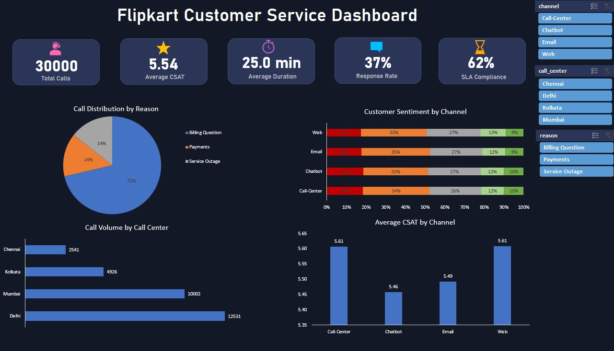

# Flipkart Customer Service Analysis

**Created by:** Omkar Malgi  
**Project:** Business Analysis – Customer Service Operations

## Project Overview

Analysis of 30,000 customer service interactions to understand customer satisfaction, support-channel performance, SLA compliance and potential customer-retention risks.

## Project Objectives

- Evaluate customer satisfaction across support channels.
- Identify major reasons for customer dissatisfaction.
- Test five business hypotheses.
- Analyse SLA compliance and call duration.
- Recommend improvements to customer support operations.

## Key Findings

| Metric | Result |
|---|---:|
| Customer service interactions | 30,000 |
| Average CSAT | 5.54 / 10 |
| CSAT response rate | 37% |
| Negative sentiment share | 51.75% |
| SLA compliance | 62% |
| Average interaction duration | 25 minutes |

## Dashboard Preview

## Key Business Insights

- Billing questions represent 72% of support interactions.
- Customer dissatisfaction is similar across all four support channels.
- Faster SLA response alone does not guarantee better customer satisfaction.
- Chatbot interactions have the lowest average CSAT among the channels.
- Improving issue resolution and billing clarity could improve customer experience.

## Methodology

Data cleaning, feature engineering, KPI analysis, PivotTables, hypothesis testing and business recommendations.

## Tools Used

Microsoft Excel, PivotTables, Data Analysis and Business Analysis.

## Project Report

[View the Complete Flipkart Customer Service Analysis Report](Flipkart_Customer_Service_Analysis_Report.pdf)

## Important Data Limitation

The dataset does not contain repeat-purchase or customer churn tracking. Customer satisfaction and sentiment are used as retention-risk proxies, not direct measurements of actual customer retention.
