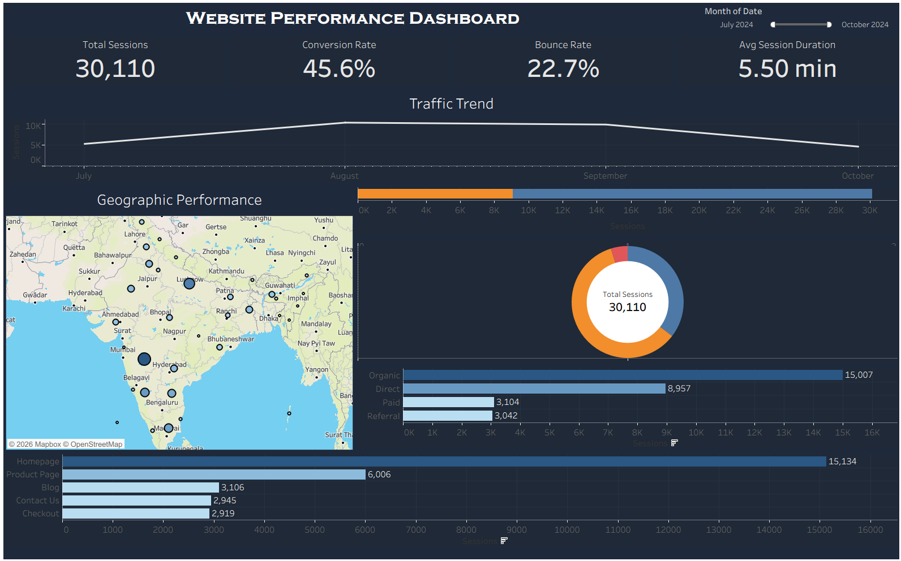

# Swiggy Website Performance Analysis

**Created by:** Omkar Malgi  
**Project:** Business Analyst Portfolio Project  
**Tool:** Tableau

## Project Overview

This project analyses Swiggy website performance using session-level data and Tableau visualization.

The objective is to understand website traffic patterns, visitor behaviour, engagement, device performance, geographical distribution and conversion performance.

## Analysis Areas

- Traffic source performance
- New vs returning visitors
- Device and browser analysis
- Geographic traffic distribution
- Landing and exit page analysis
- Page views and website sessions
- Bounce behaviour
- Average session duration
- Conversion performance

## Dashboard Preview

## Interactive Tableau Dashboard

**[View Interactive Dashboard on Tableau Public](https://public.tableau.com/app/profile/omkar.malgi/viz/SwiggyTrafficAnalysisDashboard_17889819421700/TrafficDashboard)**

## Dataset Overview

The project uses a dataset containing website traffic and session information, including traffic source, visitor type, device, browser, operating system, geographic information, landing page, exit page, campaign, page views, sessions, bounce status, session duration and conversion status.

The original dataset is not included in this public repository.

## Skills Demonstrated

- Tableau Dashboard Development
- Website Performance Analysis
- Traffic Source Analysis
- User Behaviour Analysis
- KPI Analysis
- Data Visualization
- Business Insight Generation

## Project Disclaimer

This is an independent portfolio project based on course-provided project data. It is for analytical and learning purposes and does not represent official Swiggy internal business data or performance.
